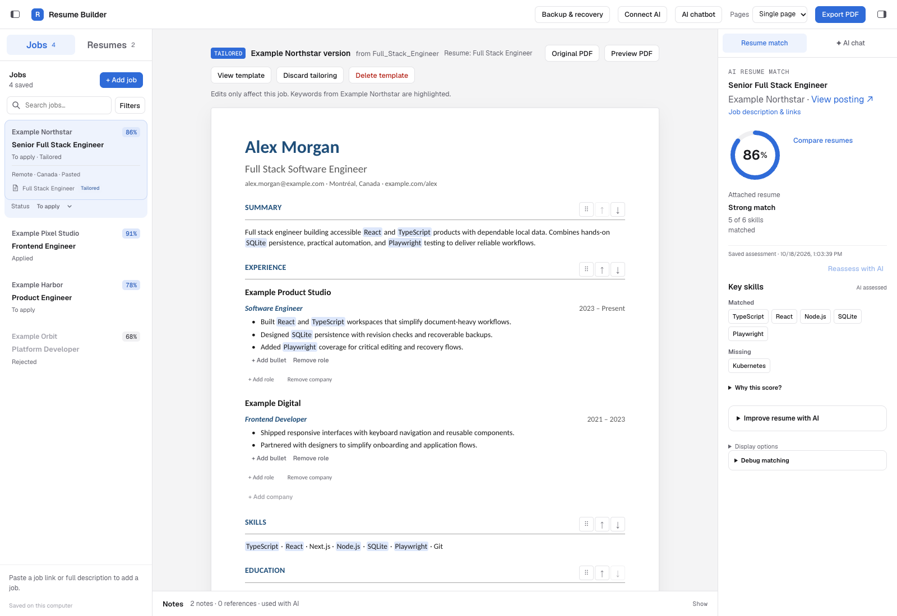
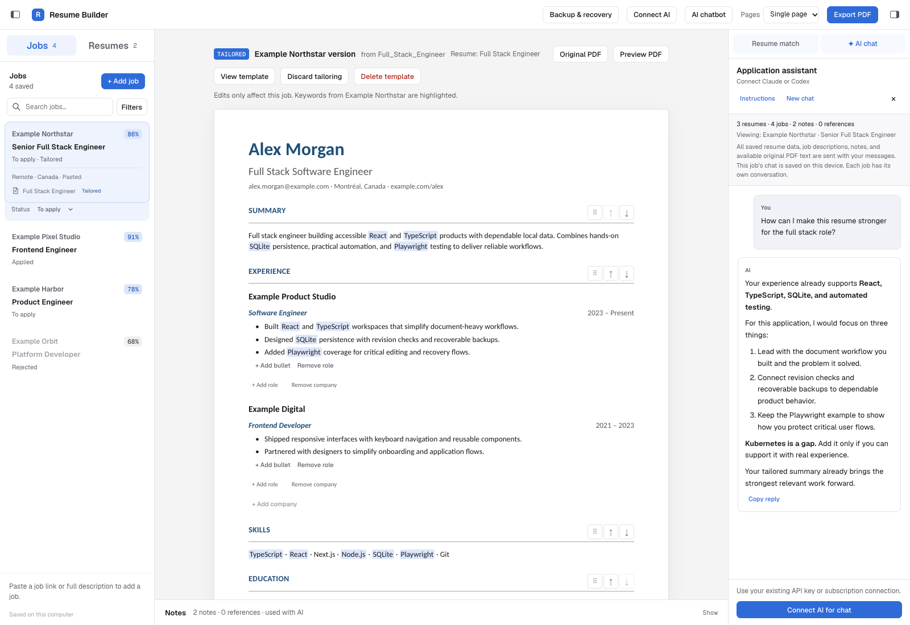

# AI Resume Builder

AI Resume Builder uses AI to analyze job postings, extract key skills, and assess how your resume demonstrates those skills. It helps you build stronger, job-specific resumes with evidence-backed feedback, clearer wording, and suggested edits you review before applying.

Built with Next.js, React, TypeScript, and SQLite, it runs locally and keeps your resume versions, saved jobs, and application notes in one workspace.

## How AI helps improve your resume

1. **Analyze the job.** Import a posting URL or paste its description. AI identifies the role and extracts key skills, tools, and qualifications, distinguishing required skills from preferred ones.
2. **Find evidence across your resume.** AI assesses the selected resume against those requirements, considering experience, project descriptions, skills, and other resume sections. It recognizes relevant evidence beyond exact keyword matches and explains matched and missing skills.
3. **Understand what to improve.** Review the match assessment, quoted supporting evidence, and gaps to see where your resume could communicate your experience more clearly.
4. **Build a better version.** Use AI chat and tailoring suggestions to improve summaries, strengthen experience bullets, and highlight relevant work using your resume, notes, and reference documents. Review before/after edits and apply the changes you choose to a job-specific resume.

Suggestions are grounded in the information you provide; missing skills are prompts to review your experience, not claims to add without support. AI features require a connected provider. The app starts with an empty workspace.

## Screenshots

### Workspace and resume matching

<a href="docs/images/workspace.png"></a>

### AI chat

<a href="docs/images/ai-chat.png"></a>

_All screenshots use fictional records. Match assessments and chat replies are illustrative; no live AI requests were made. Click any image to view it at full size._

[Reproduce these screenshots](docs/screenshots.md).

## Highlights

- **Resume editing:** PDF/DOCX import, inline editing, company/team grouping, section reordering, undo/redo, and one- or two-page PDF export.
- **Application workflow:** searchable job cards, application statuses, saved posting links, shared base templates, and independent copies tailored to each job.
- **Evidence-backed AI:** resume-to-job matching with quoted evidence, missing-skill explanations, and reviewed before/after edits. Supports Anthropic and OpenAI API connections and optional local CLI connections.
- **Recoverable storage:** SQLite autosave, revision checks against stale tabs, original document retention, portable exports, and recovery snapshots.
- **Responsive workspace:** resizable panels, keyboard controls, and a mobile tools drawer.

## Try it locally

Requires **Node.js 22.18+** and npm. `.nvmrc` pins a tested Node 22 release. SQLite uses Node's built-in `node:sqlite`, which emits an experimental warning on Node 22.

```sh
npm ci
npm run dev
```

Open **http://localhost:3000**. Create a blank resume or import a PDF/DOCX; editing and PDF export work without an AI account. AI features require your own provider connection and may incur provider charges.

For optional Google Drive import or a custom data directory:

```sh
cp .env.example .env.local
```

See the [user guide](docs/user-guide.md) for setup, AI connections, import limitations, and backup/recovery. For a local production run, use `npm run build` followed by `npm start`.

## Engineering

| Layer        | Implementation                                                                             |
| ------------ | ------------------------------------------------------------------------------------------ |
| Interface    | React 19, TypeScript, responsive CSS, Next.js App Router                                   |
| Persistence  | Local SQLite with revision checks, online backups, and browser-data migration              |
| Documents    | PDF/DOCX text extraction, schema validation, PDF generation                                |
| AI           | Provider SDKs, bounded local CLI processes, validated match evidence, redacted diagnostics |
| Verification | Node test runner, TypeScript, production build, isolated Playwright storage tests          |

The UI lives in `components/`, HTTP routes in `app/api/`, and document, persistence, and AI logic in `lib/`. [The design brief](docs/design-brief.md) records the original prototype intent; the user guide describes the implemented behavior.

Some deliberate tradeoffs: saves reject stale revisions rather than silently overwriting another tab; AI reassessment is explicit after the initial match; proposed edits require review and check that their target has not changed; job-page fetching validates public addresses, pins DNS, and limits redirects and response size.

## Privacy and scope

This is a **local, single-user application**. The provided server commands bind to `127.0.0.1`. It has no remote authentication and is not ready for a public hosted service. Publishing the source does not require exposing the running app.

Workspace data and snapshots stay on the server computer, outside the repo by default, and are **not encrypted**. API keys are saved in the browser's local storage; use a trusted browser profile. AI operations send relevant resume, job, note, or reference content to the connected provider. Chat can include the full saved workspace. Google Drive import contacts Google, and the UI loads Google Fonts. See [security guidance](SECURITY.md) before sharing diagnostics or data.

## Development checks

```sh
npm run check:public
npm run typecheck
npm test
npm run build
npm run test:storage:browser
```

The publication check requires Git and scans tracked and unignored files for sensitive paths and common credential formats. It is a guardrail, not a guarantee that every kind of private content is detected.

The storage browser suite starts its own servers with a temporary database and synthetic records. On Linux, install Chromium first with `npx playwright install --with-deps chromium`; on macOS the suite uses installed Google Chrome. Older feature browser scripts use legacy fixtures; see the guide before running those.

GitHub Actions runs these checks and an audit for high/critical dependency advisories. Dependabot checks npm packages and workflow actions weekly. See [contribution guidance](CONTRIBUTING.md) and the [publication checklist](docs/publishing.md).

## License

No open-source license has been selected yet. Public source visibility does not grant a general license to reuse or distribute this project.
